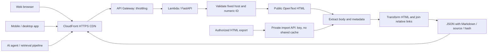

# OpenText knowledge articles → Markdown

Python 3.12 / FastAPI technical assessment. Includes a triangle exercise, pure HTML extraction and transformation, relative-link joining, a REST API, browser UI, automated tests, GitHub Actions and AWS SAM + CloudFront configuration.

Source: [GitHub repository](https://github.com/aparnasg/opentext-assessment). [Successful Build and test run](https://github.com/aparnasg/opentext-assessment/actions/runs/42351565069), as shown in the submitted GitHub Actions screenshot. The final local suite has 43 passing tests. No AWS deployment has been performed.

## Run locally

```powershell
python -m venv .venv
.venv\Scripts\Activate.ps1
python -m pip install -r requirements.txt
python -m uvicorn app.main:app --reload
```

Open http://localhost:8000 for the UI and import http://localhost:8000/openapi.json into an API client for the API contract. Interactive Swagger and ReDoc pages are disabled to keep the UI self-contained under its restrictive Content Security Policy. Run `python -m app.triangle` for the three-row, four-column triangle:

```text
*
***
****
```

Assumption: 3×4 means height × maximum width. A discrete straight hypotenuse uses ceiling rounding, yielding widths 1, 3, 4. Other interpretations are possible. The fixed `triangle()` function delegates to the separate bonus function `triangle_mn(m, n)`, which validates positive integer dimensions. Its one-line return expression generates the rows; validation and comments favor clarity over code golf. `print(triangle_mn(5, 8))` demonstrates the bonus. From the project folder run `python -c "from app.triangle import triangle_mn; print(triangle_mn(5, 8))"`.

## API and extraction

`GET /api/articles/2341059` fetches the fixed OpenText host, extracts an article container, removes page chrome, transforms headings/lists/code/tables to Markdown, resolves relative links and joins source metadata into a deterministic response:

```json
{"id":"2341059","title":"…","source_url":"https://my.opentext.com/support/article/2341059","markdown":"# …","sha256":"…"}
```

Successful public responses include a content hash ETag and a five-minute shared-cache lifetime. Exact matching `If-None-Match` returns 304. Origin conditional requests still fetch and convert; the CDN supplies the primary origin savings. Invalid IDs return 422; inaccessible/unsupported upstream content returns 502 with a useful message. Errors and imports use `Cache-Control: no-store`.

For authorized exports, set `IMPORT_API_KEY` locally and POST JSON to `/api/convert` with an `X-API-Key` header:

```json
{"source_url":"https://my.opentext.com/support/article/2341059","html":"<article><h1>Example</h1><p>A sufficiently detailed article body exported with the owner's authorization.</p></article>"}
```

Exports must contain `<article>`, `[itemprop="articleBody"]`, `.knowledge-article-content`, or the matching OpenText article record in `__NUXT_DATA__` JSON. Scripts are parsed as data and never executed. Do not send credentials, session cookies, or restricted content to a public deployment. Imports are disabled unless a key is configured, and intentionally unavailable through the CDN configuration. The AWS function ships without this key. An enterprise private import path should use identity-based authorization and tenant-separated storage/caches.

## Live-source findings and limitations

Initial requests to the number-only article routes returned generic/loading pages. A complete browser response supplied by the user confirmed article data in Nuxt JSON. Live comparison established that the text-plus-ID route serves the embedded article data to Python. The fetcher now requests `/support/article/knowledge/<id>` for number-only inputs, validates the matching ID in the JSON and converts it. The neutral `knowledge` segment was observed to work for all three assignment examples; it is an upstream routing convention, not an official documented content API. Explicit text-plus-ID URLs remain unchanged. See VALIDATION.md for live API results. Tests use synthetic HTML/JSON and do not redistribute supplied article bodies.

This implementation extracts the public webpage's embedded data; it does not execute JavaScript, bypass login or handle authenticated sessions. The observed text-plus-ID route and embedded Nuxt layout may change; monitor contract failures and prefer an approved documented API for a long-lived production integration. Other articles need validation before claiming universal support. Short bodies are conservatively rejected; complex tables, diagrams, attachments, language variants and metadata can lose fidelity. Attachment sidebar metadata is not joined into the current output. No OCR or image downloading is included. Markdown may contain untrusted text: downstream AI systems must treat article instructions as data; renderers must disable raw HTML and sanitize links. UI displays Markdown as textarea text, avoiding HTML execution.

## Architecture and multi-client distribution



The distribution contract is JSON containing Markdown, rather than presentation-specific HTML. Websites can render it safely, mobile apps can use native views, and agents can ingest it with provenance. For large-scale ingestion, add a scheduled authorized connector, queue, versioned object storage and a manifest before adding vector indexing. Such a pipeline avoids fetching the source for every CDN miss and supports revalidation, deletion and auditable content versions. It is a proposed extension, not implemented here.

## Tests and CI

```powershell
python -m pytest -q
python -m compileall -q app
```

Tests cover dimensions and input validation, URL boundaries, Markdown structure and source joining, access shells, deterministic hashes, error responses, ETags, import authorization, cache policy, upstream redirects/status/type/size. Network calls are mocked, so CI does not depend on access to OpenText. Add authorized contract fixtures before production. The UI is simple semantic HTML with labeled controls, status announcements, loading/error states and downloadable Markdown; it has no automated browser or accessibility audit yet.

Before Markdown generation, redundant nested emphasis is flattened and adjacent matching emphasis spans are merged. Heading emphasis is simplified; code blocks and their literal stars are preserved. Six regression cases cover this cleanup. Separate triangle tests cover fixed and custom dimensions and invalid inputs. See VALIDATION.md for the latest local test results.

GitHub Actions installs pinned direct dependencies, runs tests and syntax compilation, validates the SAM template, builds Lambda and uploads its build artifact. Transitive dependencies are not fully locked; use a reviewed hash-locked dependency set and security scanning for production. No automatic deployment is performed.

## Deploy and operate

Install AWS SAM CLI, configure a least-privilege AWS deployment identity, then:

```text
sam validate --lint
sam build
sam deploy --guided
```

The template defines Lambda, HTTP API throttling and CloudFront. Its default behavior uses AWS's managed CachingDisabled policy; only `/api/articles/*` uses the custom public cache with zero minimum TTL and 300-second maximum. Cookies and query strings do not affect public article representations. CDN POSTs are blocked; the origin import route is disabled by default. The API origin remains publicly reachable. Add WAF, budgets, alarms and access logs before an exposed production rollout. Lambda's execution role only grants basic logging. The linked CI workflow includes SAM validation and build; its overall success was confirmed by the user's GitHub Actions screenshot. No AWS resources were deployed.

Upstream fetches have a 5-second connect timeout, 15-second IO timeout, 20-second overall deadline, and a 2 MB decoded response limit. Exact host/path allowlisting, redirects restricted to the same HTTPS host, article route and ID (at most three hops), and disabled environment proxies reduce SSRF exposure. The API validates uploaded size after JSON decoding; an authenticated gateway payload limit is needed for a strict pre-buffering limit. API Gateway/Lambda also impose platform payload limits. Avoid logging imported bodies, keys or protected article text. Respect licensing, robots guidance and OpenText access terms; redistribution requires permission. Shared caching is appropriate only for public content. Revocations can remain cached up to five minutes; invalidate affected paths for urgent removals.

## Evaluate performance and effectiveness

Measure cold and warm Lambda duration, p50/p95/p99 client latency, error rate by cause, source latency, CloudFront hit ratio, bytes transferred and cost per 1,000 requests. Run a staged load test against an authorized test origin with cache-hit, cache-miss and source-failure scenarios. Initial proposed targets: warm CDN-hit p95 <200 ms in target regions, public error rate <1% when upstream is healthy, and >90% cache hits for repeated popular articles. These are acceptance goals, not measured results.

Build an authorized gold set across all three example IDs and varied tables/code/images. Compare title, paragraphs, heading hierarchy, links and source attribution against the browser article; track missing text, navigation leakage and stale content. For AI use, compare answer correctness, grounded citations, retrieval recall@k and prompt-injection resistance before/after conversion. For people, evaluate task completion, download success, accessibility and feedback across web/mobile/agent clients. Track revisions by content hash and test deletion/invalidation propagation. Avoid collecting personal queries or protected text in analytics.

## Submission and ownership

The source is published at [aparnasg/opentext-assessment](https://github.com/aparnasg/opentext-assessment). Review the source and confirm you can change selectors, explain cache isolation and error handling, and adapt the triangle rounding rule during the interview.

`AI_SESSION.md` contains a sanitized session summary, not the actual conversation export. The actual sanitized AI conversation must still be supplied before final submission. Remove personal data, credentials and confidential material from text, screenshots and attachments before sharing. The summary is not a substitute for that required export.
